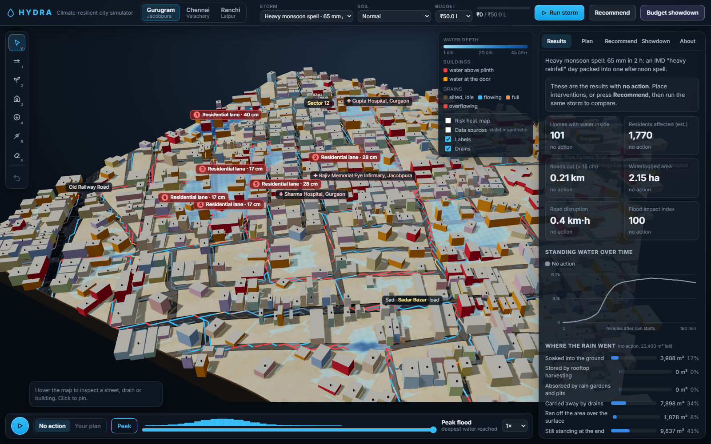

# HYDRA: climate-resilient Indian city simulator

**Every monsoon the same streets go under. HYDRA shows why, and where a limited budget does the most good.**



HYDRA is an interactive 3D simulator of a real Indian neighbourhood (Gurugram, Chennai or Ranchi), built for the WeMakeDevs × AWS hackathon. You can:
- run a heavy monsoon storm and watch it flood the streets
- place stormwater drains, rain gardens, rooftop rainwater harvesting, recharge pits and drain desilting within a fixed rupee budget
- re-run the *same* storm and compare before and after
- let HYDRA's optimizer spend the budget for you, and pit it against spending the same money without a plan

> **Thesis, shown on screen:** the right infrastructure in the right places reduces monsoon flood damage far more than the same budget spent evenly.

| Neighbourhood, storm, budget | Flood-impact cut: HYDRA plan | Flood-impact cut: even spread (avg of 3) | Homes kept dry (HYDRA vs even spread) |
|---|---|---|---|
| Gurugram (Jacobpura), heavy, ₹25 L | **15 %** | 1 % | 11 vs 4 |
| Gurugram (Jacobpura), heavy, ₹75 L | **21 %** | 3 % | 24 vs 10 |
| Chennai (Velachery), very heavy, ₹75 L | **15 %** | 1 % | 17 vs 2 |
| Ranchi (Lalpur), heavy, ₹75 L | **19 %** | 2 % | 34 vs 6 |

These figures come from the simulation engine (see `src/sim/optimizer.test.ts`), not from the UI. The best plan differs by city:
- **Chennai** (flat ground, clay soil): mostly drain desilting and relief drains.
- **Ranchi and Gurugram** (lateritic and sandy soils): rooftop harvesting and recharge pits as well.

## Demo links

- `/#gurugram`, `/#chennai`, `/#ranchi` open a neighbourhood.
- `/?demo=showdown#gurugram` runs the budget showdown on load.
- `/?demo=plan#ranchi` applies HYDRA's recommended plan and plays the storm.
- Add `noguide` to skip the welcome card, for example `/?noguide&demo=showdown#chennai`.

## What you can do

1. **Explore:** orbit the real neighbourhood in 3D. Buildings, roads and land use come from OpenStreetMap; terrain comes from AWS Open Data. Rooftop water tanks and open roadside drains are shown. Hover any street, drain or building for its numbers.
2. **See the risk:** HYDRA runs the baseline storm on load.
   - Waterlogging hotspots are ranked and named by road.
   - Homes are coloured by risk: red means water is above the plinth, amber means water is at the door.
   - Drains glow blue when flowing, amber when full and red when overflowing.
3. **Simulate:** press **Run storm** to watch the rain, the runoff, the drains filling and surcharging, and the low spots growing. Scrub through time, or switch to the **Peak** flood.
4. **Intervene within budget** (keys 1–5):

   | Intervention | How you place it | What it does | Indicative cost |
   |---|---|---|---|
   | Stormwater drain | Drag on the map | 0.4 m³/s; must connect to an outfall | ₹6,000/m |
   | Rain garden | Click | 10 × 10 m, 25 cm deep, 60 mm/h | ₹1.2 L |
   | Rooftop rainwater harvesting | Click a roof | Tank holds 40 mm of roof rain | ₹12k + ₹2.8k/m³ |
   | Recharge pit | Click | 2.5 m³ plus ~1 L/s into the aquifer | ₹40k |
   | Drain desilting | Click a drain | Restores 50 % → 90 % capacity | ₹600/m |

   Every intervention changes the physics. A drain that isn't connected to an outfall does nothing, which is exactly the lesson.
5. **Compare:** see before/after KPIs (homes flooded, residents, km of road cut, waterlogged hectares, road-km·hours, flood impact index), standing water over time, where the rain went, and an A/B toggle on the map.
6. **Recommend:** the optimizer spends the budget and explains every pick, for example *"Desilting the 160 m drain along Dhandeeswaram Nagar stops ~389 m³ of the 1,769 m³ it overflowed onto the street."* Apply it with one click.
7. **Budget showdown:** compares no action, an even spread (the average of 3 random plans) and HYDRA, all for the same budget.

## How it works

```
scripts/fetch-site.mjs   data pipeline: Overpass (OSM) + Terrain Tiles on AWS -> public/data/<site>.json (5 m grid)
src/sim/                 pure TypeScript engine; runs in Web Workers and in Vitest
  model.ts               grid, intervention catalogue, costs, validation, IMD design storms
  engine.ts              fill-and-spill pluvial flood model + drain network
  optimizer.ts           hydrology-aware greedy optimizer + "even spread" baseline
  worker.ts              simulate / optimize / showdown off the main thread
src/three/               React Three Fiber scene: terrain diorama, buildings, water shader, rain, drains, interventions
src/ui/                  panels, charts, timeline, inspector
```

**Engine** (transparent and simplified, documented in the app's *About* tab). Each minute:
1. **Rain** falls as an IMD-category design storm.
2. **Roofs** drain through downpipes, unless a rooftop harvesting tank catches the water first.
3. **Runoff** flows downhill along D8 paths on a depression-filled surface (priority-flood, Barnes et al. 2014), soaking into permeable ground until the soil saturates.
4. **Open drains** take water in through inlets and route it by gravity to outfalls (Dijkstra). They are 50 % silted and surcharge back onto the street when full.
5. **Low spots** fill like reservoirs (hypsometric level) and spill downstream when full.
6. **Moving water** gets a Manning normal depth.

Mass balance closes to < 0.01 m³ on 40,000 m³ storms, and a storm runs in about 0.5 s.

**Optimizer:**
1. Simulate the storm.
2. Find the harmful low spots: water above 10 cm, weighted by road class, residents at the door and critical buildings.
3. Trace where each cell's runoff ends up, through chains of low spots spilling into each other.
4. Score every candidate (roof harvesting, rain garden, recharge pit, a relief drain found with Dijkstra to a drain with spare capacity or the trunk outfall, desilting) by harmful water removed per rupee.
5. Pick lazily and greedily within the round budget, then re-simulate and refine for up to 6 rounds.

## Data and honesty

- **OpenStreetMap** via the Overpass API (© OpenStreetMap contributors, ODbL): buildings and their levels, roads by class and name, land use, schools and hospitals.
- **Terrain Tiles on the AWS Registry of Open Data** (`s3://elevation-tiles-prod`, terrarium, SRTM-derived). The elevation is smoothed to remove 1 m steps in the source data, and hydrologically conditioned: closed depressions deeper than 40 cm are treated as artefacts.
- **Synthetic, and labelled in the app** (toggle *Data sources*):
  - building infill where OSM has gaps (most of Ranchi)
  - missing building levels, plinth heights and resident estimates
  - the roadside drain layout, sizes and silt state
  - micro-relief
  - soil infiltration factors

  These assumptions are listed in the *About* tab.

This is a screening and decision-support tool, not a hydraulic design tool. Unit costs are indicative; use the local CPWD or PWD schedule of rates for real budgets.

## Run it

```bash
npm install
npm run dev          # http://localhost:5173
npm test             # engine + optimizer tests (mass balance, HYDRA beats even spread)
npm run build        # static site in dist/
npm run data         # optional: re-fetch OSM + terrain for all sites (cached in data/raw)
```

## Deploy on AWS

HYDRA is a static site; the engine runs in the browser.
- **AWS Amplify Hosting:** connect the repo; `amplify.yml` builds `dist/`.
- **S3 + CloudFront:** `npm run build`, upload `dist/` to a bucket, and serve it through CloudFront with the default root object `index.html`.

## Roadmap

- Heat-risk layer (land-surface temperature, roof albedo, tree cover).
- An Amazon Bedrock "ward officer brief" that summarises the chosen plan in English and Hindi.
- Upload your own ward boundary.
