<div align="center">

# 💧 HYDRA

### 3D urban flood & heat intelligence, with budget optimization, for Indian neighbourhoods

**Each monsoon, the same streets flood. Each summer, the same bus stops get too hot.<br/>HYDRA shows why, and where a limited budget does the most good.**

[](https://main.d3dmcevnvvv968.amplifyapp.com)
[](https://www.youtube.com/watch?v=CZAD1YekapY)
[](https://vnomcfk5el.execute-api.ap-south-1.amazonaws.com/health)


-ff9900)


[**Live demo**](https://main.d3dmcevnvvv968.amplifyapp.com) · [**Video**](https://www.youtube.com/watch?v=CZAD1YekapY) · [**Architecture**](#4-architecture-hld) · [**Low-level design**](#7-low-level-design-lld) · [**Deployment**](#11-deployment) · [**Technical design**](TECHNICAL.md)

</div>


> HYDRA simulates a storm or a hot day on a real 600 m × 600 m Indian neighbourhood in 3D, finds the cause of each problem, and spends a rupee budget where it removes the most harm. On the same budget, the HYDRA plan cuts flood impact by **15–21 %**, while the same money spread evenly cuts it by **1–3 %**. All calculations run on **AWS Lambda**. The same engine runs in the browser if the API cannot be reached.

---

## Contents

1. [Overview](#1-overview)
2. [Results](#2-results)
3. [Links and quick tour](#3-links-and-quick-tour)
4. [Architecture (HLD)](#4-architecture-hld)
5. [AWS services](#5-aws-services)
6. [Request flows](#6-request-flows)
7. [Low-level design (LLD)](#7-low-level-design-lld)
8. [Non-functional properties](#8-non-functional-properties)
9. [Use the application](#9-use-the-application)
10. [Install and run](#10-install-and-run)
11. [Deployment](#11-deployment)
12. [Testing](#12-testing)
13. [Data sources and limits](#13-data-sources-and-limits)
14. [Repository layout and tech stack](#14-repository-layout-and-tech-stack)
15. [Team](#15-team)
16. [Roadmap](#16-roadmap)
17. [Related documents](#17-related-documents)

---

## 1. Overview

### 1.1 The problem

Indian cities spend money on drains and shade every year, but often without a plan. The money is spread across wards, the same streets flood again, and the same bus stops stay in full sun. A planner cannot see *why* a street floods, or *which* fix gives the most benefit per rupee.

### 1.2 What HYDRA does

HYDRA is an interactive 3D simulator and decision-support tool for **municipal planners, ward officers and urban-resilience teams**.

| Mode | What it simulates | What you can add |
|---|---|---|
| **Flood** | A monsoon design storm. Rain runs downhill, fills the drains, overflows silted drains and collects in low streets. | Stormwater drains, rain gardens, rooftop rainwater tanks, recharge pits, drain desilting |
| **Heat** | The sun across a hot day. Shadows, surface heating and air heat, weighted by where people wait. | Street trees, shade canopies, shaded walkways, cool roofs |

In each mode you can:

1. **Simulate** the same conditions before and after a change.
2. **Recommend:** let the optimizer spend the budget. Each choice comes with a plain-language reason.
3. **Showdown:** compare no action, the same money spread evenly (3 random plans), and the HYDRA plan.
4. **Report:** analytics dashboard, PDF report, and a one-page officer brief in English and Hindi.

The two modes share the neighbourhood, camera and layout. Their models, plans, budgets and results are fully separate.

### 1.3 Neighbourhoods

| Neighbourhood | City | Ground and soil |
|---|---|---|
| Jacobpura, Old Gurugram | Gurugram, Haryana | Slope at the foot of the Aravalli hills. Much paved area. |
| Velachery | Chennai, Tamil Nadu | Very flat, low ground on a former wetland. Clay soil. |
| Lalpur | Ranchi, Jharkhand | Plateau with hills. Lateritic soil. |
| **Any spot in India** | **+ Area** | Built on demand from OpenStreetMap and AWS Terrain Tiles by a Lambda worker, in about one minute |

**Thesis:** the correct infrastructure in the correct places decreases flood damage much more than the same budget spent evenly.

---

## 2. Results

The engine calculates these values. The tests in [`src/sim/flood/optimizer.test.ts`](src/sim/flood/optimizer.test.ts) and [`src/sim/heat/optimizer.test.ts`](src/sim/heat/optimizer.test.ts) check them.

### 2.1 Flood mode

| Neighbourhood, storm, budget | Decrease in flood impact: **HYDRA** | Even spread (average of 3) | Homes that stay dry: HYDRA vs even spread |
|---|---|---|---|
| Gurugram, heavy, ₹25 L | **15 %** | 1 % | 11 vs 4 |
| Gurugram, heavy, ₹75 L | **21 %** | 3 % | 24 vs 10 |
| Chennai, very heavy, ₹75 L | **15 %** | 1 % | 17 vs 2 |
| Ranchi, heavy, ₹75 L | **19 %** | 2 % | 34 vs 6 |

The best plan is different in each city. **Chennai** (flat, clay) gets mostly drain desilting and relief drains. **Ranchi and Gurugram** (lateritic and sandy soils) also get rooftop tanks and recharge pits.

### 2.2 Heat mode

Pre-monsoon heatwave afternoon, 44 °C, 12:00–16:00, budget ₹25 L.

| Neighbourhood | High-exposure places: no action → even spread → **HYDRA** | Shade where people wait: no action → even spread → **HYDRA** |
|---|---|---|
| Gurugram | 10 → 9.7 → **5** | 15 % → 16 % → **38 %** |
| Chennai | 5 → 5.0 → **1** | 27 % → 27 % → **61 %** |
| Ranchi | 7 → 7.0 → **1** | 26 % → 27 % → **67 %** |

---

## 3. Links and quick tour

| Resource | Link |
|---|---|
| Live application (AWS Amplify) | https://main.d3dmcevnvvv968.amplifyapp.com |
| Demo video | https://www.youtube.com/watch?v=CZAD1YekapY |
| Live API health check | https://vnomcfk5el.execute-api.ap-south-1.amazonaws.com/health |
| Full technical design | [TECHNICAL.md](TECHNICAL.md) |
| Backend reference | [backend/README.md](backend/README.md) |

**Two-minute tour for reviewers** (each link opens a ready state):

| See | Open |
|---|---|
| The budget showdown: no action vs even spread vs HYDRA | [`?demo=showdown#gurugram`](https://main.d3dmcevnvvv968.amplifyapp.com/?demo=showdown#gurugram) |
| The HYDRA flood plan applied, storm running | [`?demo=plan#ranchi`](https://main.d3dmcevnvvv968.amplifyapp.com/?demo=plan#ranchi) |
| The HYDRA heat plan in Chennai | [`?demo=plan#chennai/heat`](https://main.d3dmcevnvvv968.amplifyapp.com/?demo=plan#chennai/heat) |
| Heat mode | [`#chennai/heat`](https://main.d3dmcevnvvv968.amplifyapp.com/#chennai/heat) |
| The guided tour | [`?tour`](https://main.d3dmcevnvvv968.amplifyapp.com/?tour) |

Each result panel shows where it was calculated: *Calculated by the HYDRA API* (Lambda) or *in the browser*.

---

## 4. Architecture (HLD)

### 4.1 System overview

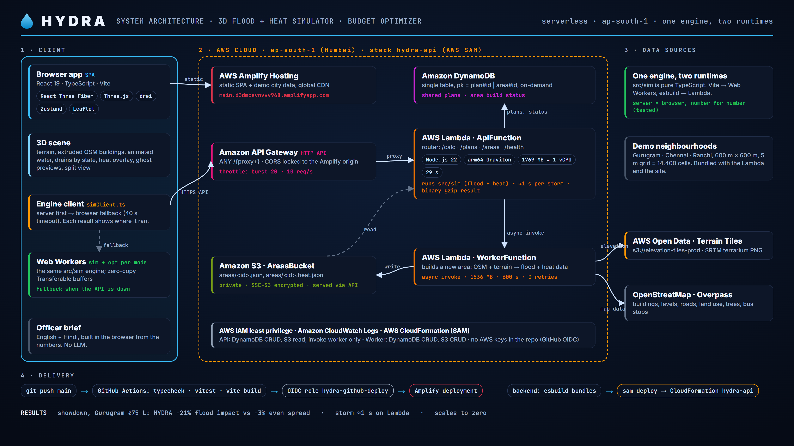

### 4.2 System context

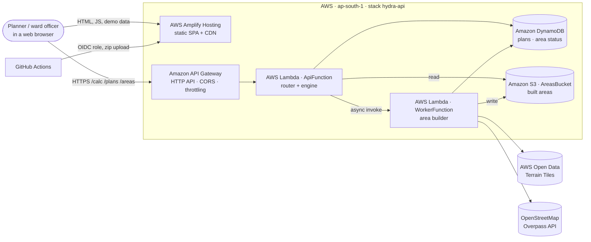

### 4.3 Logical layers

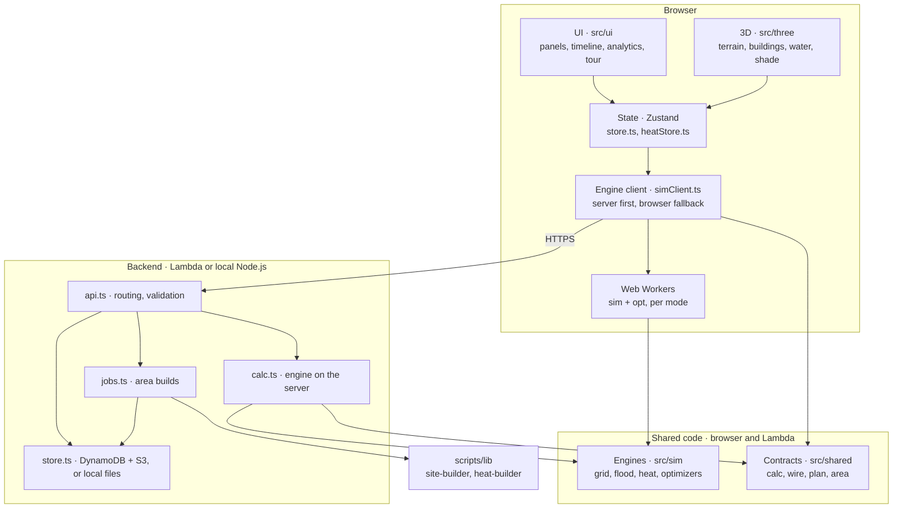

### 4.4 Key design decisions

| Decision | Why |
|---|---|
| **One engine, two runtimes** | `src/sim` is pure TypeScript with no DOM or Node APIs. Vite bundles it into Web Workers, esbuild bundles it into Lambda. Server and browser results are identical; [`backend/test/calc.test.ts`](backend/test/calc.test.ts) checks this. |
| **Server first, browser fallback** | The backend is optional. A build without `VITE_API_URL` is a complete static product; only share links and **+ Area** disappear. |
| **The server never trusts client numbers** | The browser sends only IDs and a plan. The server loads the site itself, checks every intervention against the placement rules and calculates every cost again. |
| **Binary results** | A storm result is mostly typed arrays (water depth per cell per frame). A custom format ([`src/shared/wire.ts`](src/shared/wire.ts)) plus gzip keeps a 6-hour storm under 1 MB. |
| **Asynchronous area builds** | A build takes 20 s to a few minutes, longer than the 29 s API Gateway limit. The API writes a job record, invokes the worker asynchronously, and the browser polls. |
| **Single-table DynamoDB** | Only two access patterns, both get-by-ID. One hash key with a type prefix (`plan#`, `area#`) is enough. |
| **1769 MB Lambda** | Exactly one full vCPU. The engine is single-threaded, so more memory buys nothing. |
| **arm64 (Graviton)** | Lower cost per GB-second; no native dependencies. |
| **Flood and heat fully separate** | `src/sim/heat` never imports `src/sim/flood`. They share only the grid. Separate workers, stores, plans and budgets. |

---

## 5. AWS services

| AWS service | Function in HYDRA | Configuration | Defined in |
|---|---|---|---|
| **AWS Amplify Hosting** | Hosts the static web application and the demo city data | Manual-deploy app; GitHub Actions uploads each build | [deploy.yml](.github/workflows/deploy.yml), [amplify.yml](amplify.yml) |
| **Amazon API Gateway (HTTP API)** | Public entry point for all API calls | One `ANY /{proxy+}` route · CORS locked to the Amplify origin · throttling burst 20, 10 req/s | [template.yaml](backend/template.yaml) |
| **AWS Lambda · `ApiFunction`** | Routes requests, runs the flood and heat engines, saves plans, starts area builds, serves built areas | Node.js 22 · arm64 · 1769 MB · 29 s | [lambda-api.ts](backend/src/lambda-api.ts) |
| **AWS Lambda · `WorkerFunction`** | Builds a new neighbourhood from OpenStreetMap and terrain data | Asynchronous (`Event`) · 1536 MB · 600 s · 0 retries | [lambda-worker.ts](backend/src/lambda-worker.ts) |
| **Amazon DynamoDB** | Shared plans and area build status | One table · on-demand · hash key `pk` | [store.ts](backend/src/store.ts) |
| **Amazon S3 · `AreasBucket`** | Built neighbourhoods (`areas/<id>.json`, `areas/<id>.heat.json`) | Private (all public access blocked) · SSE-S3 (AES-256) · served only through the API | [template.yaml](backend/template.yaml) |
| **AWS Registry of Open Data · Terrain Tiles** | Elevation for every neighbourhood | `s3://elevation-tiles-prod`, SRTM-derived terrarium PNG | [site-builder.mjs](scripts/lib/site-builder.mjs) |
| **AWS IAM** | Least privilege per function; GitHub deploys through an OIDC role, so the repository holds no AWS keys | SAM policy templates · role `hydra-github-deploy` | [template.yaml](backend/template.yaml) |
| **AWS SAM / AWS CloudFormation** | Infrastructure as code | Stack `hydra-api` in `ap-south-1` | [template.yaml](backend/template.yaml), [samconfig.toml](backend/samconfig.toml) |
| **Amazon CloudWatch Logs** | Lambda logs, failed jobs | Default Lambda logging | — |

**AWS open-source tools used:** AWS SAM CLI, AWS SDK for JavaScript v3 (`client-dynamodb`, `lib-dynamodb`, `client-s3`, `client-lambda`), and the `aws-actions/configure-aws-credentials` GitHub Action.

**Left out on purpose:**

- **Amazon Bedrock.** The officer brief (English and Hindi) is generated in the browser from the simulation's own numbers. The brief is deterministic and the running cost stays at zero.
- **Amazon CloudFront.** Amplify Hosting already includes a CDN. S3 + CloudFront is the documented alternative.

### 5.1 IAM permissions

| Principal | Permissions |
|---|---|
| `ApiFunction` | `DynamoDBCrudPolicy` (table), `S3ReadPolicy` (areas bucket), `LambdaInvokePolicy` (worker only) |
| `WorkerFunction` | `DynamoDBCrudPolicy` (table), `S3CrudPolicy` (areas bucket) |
| `hydra-github-deploy` (OIDC) | Amplify deployment to this app's `main` branch only |

---

## 6. Request flows

### 6.1 Run a calculation (simulate, optimize, showdown)

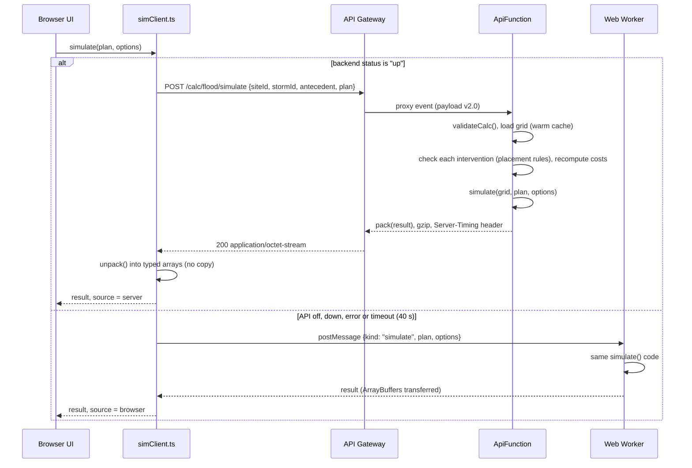

At start-up the app calls `GET /health` once and sets the backend status to `up`, `down` or `off`.

### 6.2 Share a plan

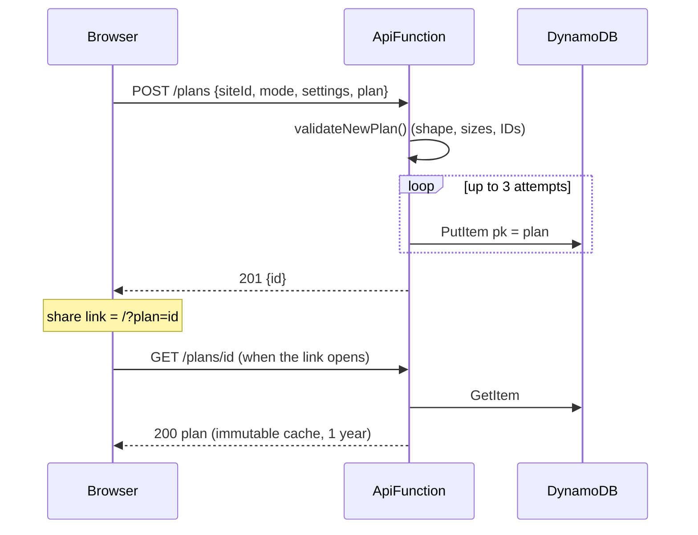

### 6.3 Add a neighbourhood (+ Area)

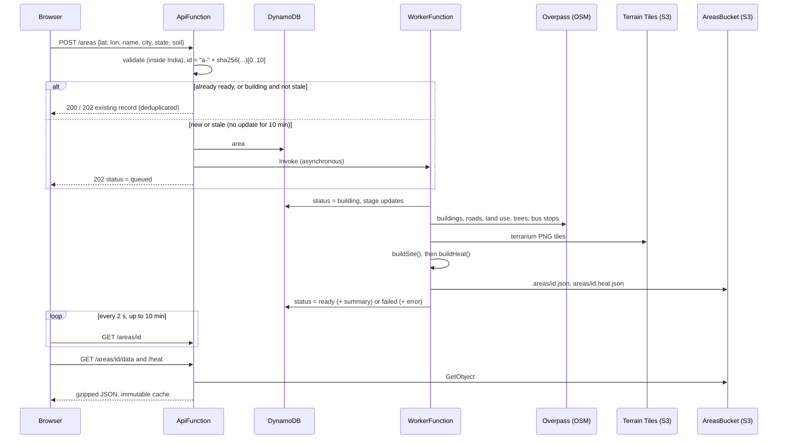

### 6.4 Area build status

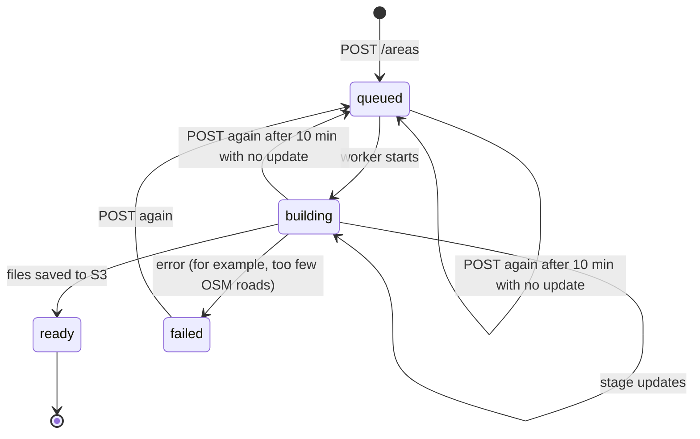

---

## 7. Low-level design (LLD)

### 7.1 Module map

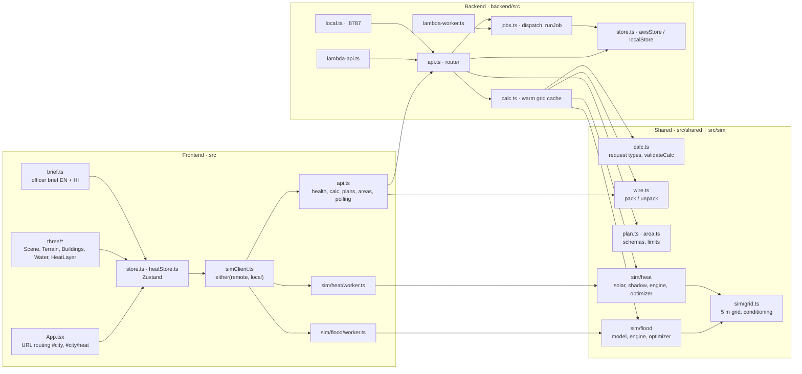

### 7.2 Data model

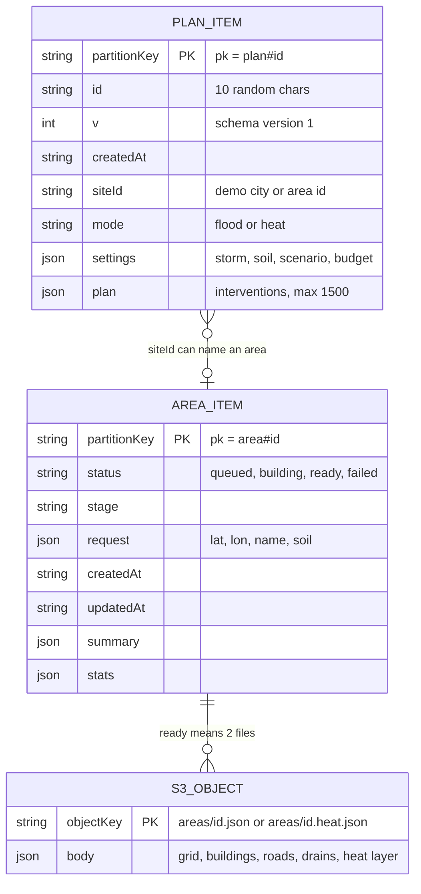

| Store | Key | Written by | Notes |
|---|---|---|---|
| DynamoDB | `plan#<id>` | API | `id` is 10 random characters from an unambiguous alphabet. A conditional put prevents an overwrite. |
| DynamoDB | `area#<id>` | API (`queued`), worker (`building`, `ready`, `failed`) | `id = "a-" + sha256(rounded lat/lon, soil, names)[0..10]`: deterministic, so repeat requests deduplicate. |
| S3 | `areas/<id>.json` | Worker | Site data: 5 m grid, elevation, cover, buildings, roads, drains, outfalls, data-source notes |
| S3 | `areas/<id>.heat.json` | Worker | Heat layer: trees, bus stops, markets, footfall points |

The three demo cities are not in S3. The build copies `public/data` into the Lambda bundle, and the browser loads them from Amplify.

**Storage abstraction** ([store.ts](backend/src/store.ts)): one `Store` interface (`get`, `put` with `ifAbsent`, `getFile`, `putFile`) with two implementations, `awsStore` (DynamoDB + S3) and `localStore` (JSON files in `backend/.data`). `STORAGE=aws` selects the AWS one, so the same router runs on Lambda and on a laptop.

### 7.3 API reference

Base URL: `https://vnomcfk5el.execute-api.ap-south-1.amazonaws.com` (the `ApiUrl` output of the stack).

| Method | Path | Request | Response |
|---|---|---|---|
| GET | `/health` | — | `{ ok, storage }` |
| POST | `/plans` | `NewPlan` | `201 { id }` |
| GET | `/plans/{id}` | — | `SavedPlan`, immutable cache |
| POST | `/areas` | `AreaRequest` | `202 AreaMeta` (`200` if already ready) |
| GET | `/areas/{id}` | — | `AreaMeta` (status, stage, error, stats) |
| GET | `/areas/{id}/data` | — | site JSON (gzip), immutable |
| GET | `/areas/{id}/heat` | — | heat JSON (gzip), immutable |
| POST | `/calc/{flood\|heat}/simulate` | `FloodCalc` / `HeatCalc` | binary ([wire.ts](src/shared/wire.ts)), gzip |
| POST | `/calc/{flood\|heat}/optimize` | same + `budget` | JSON `OptimizeResult` |
| POST | `/calc/{flood\|heat}/showdown` | same + `budget` | JSON `ShowdownResult` |

```ts
FloodCalc = { siteId, stormId, antecedent, plan?: Intervention[], budget?: number }
HeatCalc  = { siteId, scenarioId, windowId, plan?: HeatIntervention[], budget?: number }
```

Errors return `{ error: string }` with `400` (validation), `404`, `413` (body over 400 KB) or `500`. `/calc` responses carry `Server-Timing: engine;dur=<ms>`.

```bash
# Try it: health, then a storm on the Gurugram demo site
curl https://vnomcfk5el.execute-api.ap-south-1.amazonaws.com/health
curl -X POST https://vnomcfk5el.execute-api.ap-south-1.amazonaws.com/calc/flood/optimize \
  -H 'content-type: application/json' \
  -d '{"siteId":"gurugram","stormId":"heavy","antecedent":"normal","budget":2500000}'
```

**Routing** ([api.ts](backend/src/api.ts)): the path is split into `/{root}/{id}/{sub}`, normalised to a key such as `POST /calc/:id/simulate`, and a `switch` dispatches it. IDs must match `^[A-Za-z0-9-]{1,40}$`. The Lambda adapter and the local server call the same `handle(cfg, store, req)`; there is no framework.

### 7.4 Binary wire format

[src/shared/wire.ts](src/shared/wire.ts), used by Node.js and the browser:

```
┌──────────────┬──────────────────────┬─────────┬──────────────────┬──────────────────┬─────┐
│ u32 LE: N    │ header JSON (N bytes)│ pad → 8 │ typed array 1    │ typed array 2    │ ... │
│ header bytes │ {…, depth: {$array}} │         │ (padded to 8 B)  │ (padded to 8 B)  │     │
└──────────────┴──────────────────────┴─────────┴──────────────────┴──────────────────┴─────┘
```

During `JSON.stringify`, each typed array (`Uint8`, `Uint16`, `Int32`, `Float32`, `Float64`) becomes `{ $array: type, offset, length }` and its bytes go after the header. `unpack` makes typed-array views directly over the received `ArrayBuffer`, with no copy. The 8-byte padding keeps `Float64Array` views aligned.

### 7.5 The grid

[src/sim/grid.ts](src/sim/grid.ts) turns site JSON into typed arrays on a **5 m grid**: a 600 m square is 120 × 120 = **14,400 cells**.

- `z: Float64Array` elevation · `cover: Uint8Array` surface type · `bldg / road / drain: Int32Array` owner IDs per cell
- Derived lists: cells per building and road, building frontage (downpipes, doorsteps), courtyards, drain units, outfalls
- **Hydrological conditioning:** priority-flood from the edge, with buildings as walls (binary heap). Closed basins deeper than **40 cm** are raised to 40 cm: shallower ones are real waterlogging spots, deeper ones are SRTM artefacts.

### 7.6 Flood engine

[src/sim/flood/engine.ts](src/sim/flood/engine.ts) · time step: one minute.

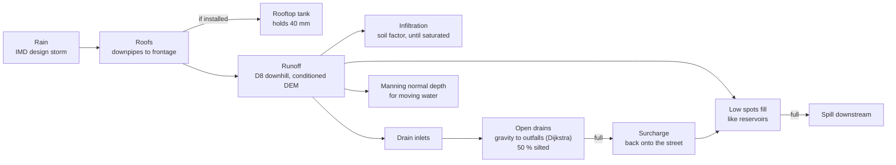

- Interventions change the physics: a drain without an outfall does nothing; desilting raises capacity from 50 % to 90 %; rain gardens and recharge pits add storage and infiltration.
- **Mass balance** closes to under 0.01 m³ on a 40,000 m³ storm.
- **Outputs:** water depth per frame, drain load, maximum depth, time over threshold, surcharge, doorstep depth; KPIs: homes flooded, residents affected, road-km cut, waterlogged hectares, road-km·hours, flood impact index.

### 7.7 Flood optimizer

[src/sim/flood/optimizer.ts](src/sim/flood/optimizer.ts)

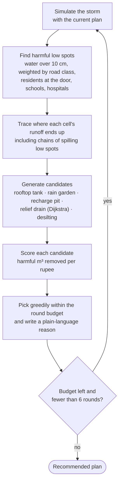

Example reason: *"Desilting the 160 m drain along Dhandeeswaram Nagar stops ~389 m³ of the 1,769 m³ it overflowed onto the street."*

**Showdown** runs no action, three random even-spread plans (same budget, valid spots) and the HYDRA plan under the same storm.

### 7.8 Heat engine and optimizer

[src/sim/heat](src/sim/heat)

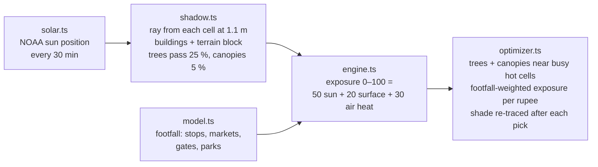

The exposure index is relative: use it to compare places and plans. It is not UTCI or WBGT and does not predict health effects. A full day traces in about 50 ms; a ₹25 L recommendation takes about 0.2 s.

### 7.9 Frontend runtime

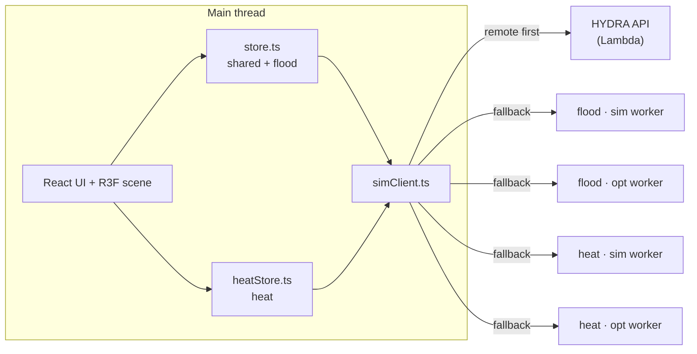

- Each mode has two workers: `sim` for quick runs, `opt` for heavy optimisation, so the UI stays responsive. Requests match by sequence ID; progress messages stream back.
- Simulation buffers move from worker to main thread as `Transferable`s (zero copy).
- **3D scene:** terrain mesh from the DEM, extruded OSM buildings, animated water from depth frames, drains coloured by state (flowing, full, overflowing), heat overlay and pins, ghost previews for placement, before/after split view.
- **URL contract:** `#<city>`, `#<city>/heat`, `?plan=<id>`, `?demo=plan|showdown`, `?tour`, `noguide`.
- **Officer brief** ([brief.ts](src/brief.ts)): template-based, English and Hindi, from the before/after numbers. No LLM call.

### 7.10 Data pipeline

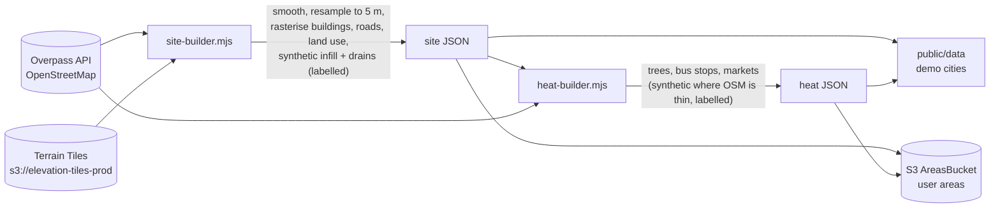

The same builders run in `npm run data` (demo cities) and in the worker Lambda (user areas).

---

## 8. Non-functional properties

### 8.1 Performance

| Operation | Time |
|---|---|
| Flood storm simulation | ~0.5 s in the browser · ~1 s end to end on Lambda |
| Flood recommendation | ~2.5 s on Lambda |
| Slowest showdown (₹2 Cr, 6-hour storm) | ~6 s on Lambda |
| Heat day trace | ~50 ms |
| Heat recommendation (₹25 L) | ~0.2 s |
| Storm result over the wire | under 1 MB gzipped (6-hour storm) |
| Site grid load | ~100 ms, then kept in a warm cache of 8 sites |
| Area build | 20 s to a few minutes (asynchronous) |

### 8.2 Security

- **Validation at the boundary:** 400 KB body limit, JSON parse guard, ID pattern, schema validators shared with the frontend (`validateNewPlan`, `validateAreaRequest`, `validateCalc`), item caps (1,500 interventions, 600 cells each), India bounding box for new areas.
- **Server-side recomputation:** placement rules and costs are checked again on the server; no result number comes from the client.
- **Least-privilege IAM:** only the worker can write to S3; the API can only read it.
- **Private, encrypted S3:** all public access blocked, SSE-S3.
- **CORS** locked to the Amplify origin in production; **throttling** at burst 20, 10 req/s.
- **No long-lived secrets:** GitHub Actions assumes a narrow role through OIDC.
- **No personal data:** plans and areas contain only geometry and settings.

### 8.3 Reliability

- Browser fallback for every calculation if the API is down, slow (40 s timeout) or returns an error.
- Conditional writes prevent plan-ID collisions (3 attempts).
- Stale-build detection (10 min) restarts an area build if a worker died; worker retries are off to prevent duplicate builds.
- Deterministic area IDs deduplicate concurrent requests for the same spot.
- Immutable caching for plans and built areas, which never change.

### 8.4 Cost

Everything scales to zero: Lambda per request, DynamoDB on demand, S3 for a few MB, Amplify Hosting. No Bedrock, no always-on compute.

---

## 9. Use the application

### 9.1 Flood mode

1. Open a neighbourhood. HYDRA runs the baseline storm.
2. Read the risk: the hotspot list names the worst low areas by road. **Red** homes have water above the plinth, **amber** homes have water at the door. Drains are **blue** (flowing), **amber** (full) or **red** (overflowing).
3. Push **Run storm** and move the timeline.
4. Add interventions with keys `1`–`5`:

   | Intervention | How to place it | Effect | Approx. cost |
   |---|---|---|---|
   | Stormwater drain | Drag on the map | 0.4 m³/s; must connect to an outfall | ₹6,000/m |
   | Rain garden | Click | 10 × 10 m, 25 cm deep, 60 mm/h | ₹1.2 L |
   | Rooftop rainwater tank | Click a roof | Holds 40 mm of roof rain | ₹12k + ₹2.8k/m³ |
   | Recharge pit | Click | 2.5 m³ and ~1 L/s into the ground | ₹40k |
   | Drain desilting | Click a drain | Capacity 50 % → 90 % | ₹600/m |

5. Push **Recommend**, then **Apply**. Open **Showdown** to compare the three ways to spend the budget.

### 9.2 Heat mode

1. Select the day (heatwave, humid hot day, summer day, monsoon break) and the hours.
2. Read the ground colours and the pins on bus stops, markets, gates and parks. Push **Play the day** to watch the shadows.
3. Add interventions with keys `1`–`4`:

   | Intervention | How to place it | Effect | Approx. cost |
   |---|---|---|---|
   | Street tree | Click open ground, paving or a park | Crown 8 m high, 3.5 m radius; passes 25 % of the sun | ₹12,000 |
   | Shade canopy | Click a stop, market or street cell | 5 × 5 m roof; stops 95 % of the sun | ₹1.5 L |
   | Shaded walkway | Drag along a footpath | Continuous canopy | ₹7,500/m |
   | Cool roof | Click a roof | Roof albedo 0.2 → 0.7 | ₹350/m² |

### 9.3 Other functions

| Function | How |
|---|---|
| Analytics | Push `A`: timelines, distributions, drain load, hotspots, cost and benefit; CSV export |
| Split view | The map before and after the plan, side by side |
| Saved plans | Compare saved plans side by side |
| PDF report | One click |
| Officer brief | **Plan** tab → **Officer brief**: one page in English and Hindi |
| Share link | **Copy share link** (needs the backend) |
| Add a neighbourhood | **+ Area** → pick a built-up spot in India → name, soil → build (~1 min, needs the backend) |
| Guided tour | Opens on the first visit; push `T` to see it again |
| Map controls | Drag to orbit; Shift-drag or Space to pan; the wheel zooms to the pointer |

> **NOTE:** A drain that does not connect to an outfall has no effect. This is intentional.

---

## 10. Install and run

### 10.1 Requirements

- Node.js 22.12 or newer, npm
- AWS SAM CLI and AWS credentials (only to deploy the backend)

### 10.2 Quick start

```bash
git clone https://github.com/krrishrastogi05/Hydra--WemakeDevsXAWS.git
cd Hydra--WemakeDevsXAWS
npm install
npm run dev                      # http://localhost:5173, engine in the browser
```

To run the backend on your computer as well (data in `backend/.data`, no AWS):

```bash
npm --prefix backend install
npm run api                      # http://localhost:8787, in a second terminal
```

### 10.3 Commands

| Command | Function |
|---|---|
| `npm run dev` | Development server |
| `npm run build` | Static site in `dist/` |
| `npm run typecheck` | TypeScript check |
| `npm test` | Engine and optimizer tests (Vitest) |
| `npm run data` / `npm run data:heat` | Rebuild the demo flood / heat data from OpenStreetMap and AWS Terrain Tiles |
| `npm run api` | Local API on :8787 |
| `npm run api:test` | API tests, no AWS or network needed |
| `npm run api:build` | Bundle the two Lambda functions |

### 10.4 Environment variables

| Variable | Where | Purpose |
|---|---|---|
| `VITE_API_URL` | Frontend build | API base URL; empty means a fully static site |
| `STORAGE` | Lambda | `aws` or `local` |
| `TABLE_NAME`, `BUCKET_NAME` | Lambda | DynamoDB table, S3 bucket |
| `WORKER_FUNCTION` | API Lambda | Worker to invoke |
| `ALLOW_ORIGIN` | API Lambda | CORS origin |
| `SITE_DATA_DIR`, `DATA_DIR` | Backend | Demo data path, local storage path |

---

## 11. Deployment

### 11.1 Live stack

| Item | Value |
|---|---|
| Region | `ap-south-1` (Mumbai) |
| Frontend | AWS Amplify app `d3dmcevnvvv968`, branch `main` → https://main.d3dmcevnvvv968.amplifyapp.com |
| Backend stack | CloudFormation `hydra-api` (AWS SAM) |
| API | https://vnomcfk5el.execute-api.ap-south-1.amazonaws.com |
| CI role | `hydra-github-deploy`, assumed through GitHub OIDC |

### 11.2 Pipeline

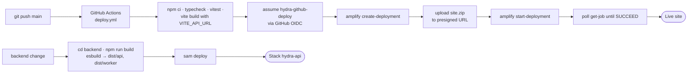

**Frontend:** every push to `main` runs [.github/workflows/deploy.yml](.github/workflows/deploy.yml). It tests, builds, gets short-lived AWS credentials through OIDC and uploads the site to Amplify. No AWS keys are stored in the repository.

**Backend:** deploy by hand after a change in `backend/`:

```bash
cd backend
npm run build          # esbuild: dist/api (with the demo cities), dist/worker
sam deploy             # uses samconfig.toml: stack hydra-api, ap-south-1, AllowOrigin = Amplify URL
```

Copy the `ApiUrl` output into `VITE_API_URL` in the workflow if the stack is new. If `VITE_API_URL` is empty, the build is a static site: everything works except share links and **+ Area**. You can also serve `dist/` from Amazon S3 + CloudFront (default root object `index.html`).

---

## 12. Testing

| Suite | Runner | Covers |
|---|---|---|
| [`src/sim/flood/engine.test.ts`](src/sim/flood/engine.test.ts) | Vitest | Mass balance, drain behaviour, interventions |
| [`src/sim/flood/optimizer.test.ts`](src/sim/flood/optimizer.test.ts) | Vitest | HYDRA vs even spread per city (the numbers in [Results](#2-results)) |
| [`src/sim/heat/engine.test.ts`](src/sim/heat/engine.test.ts), [`optimizer.test.ts`](src/sim/heat/optimizer.test.ts) | Vitest | Sun, shade, exposure, heat plans |
| [`src/shared/wire.test.ts`](src/shared/wire.test.ts) | Vitest | Binary pack / unpack round trip |
| [`src/brief.test.ts`](src/brief.test.ts) | Vitest | Officer brief |
| [`backend/test/api.test.ts`](backend/test/api.test.ts) | node --test | Routes, validation, plans, areas (local store) |
| [`backend/test/calc.test.ts`](backend/test/calc.test.ts) | node --test | Server results equal browser results, number for number |

CI runs the typecheck and Vitest on every push before it deploys.

---

## 13. Data sources and limits

| Source | Data |
|---|---|
| **OpenStreetMap** (Overpass API, © OpenStreetMap contributors, ODbL) | Buildings, building levels, roads, land use, schools, hospitals, trees, bus stops |
| **Terrain Tiles, AWS Registry of Open Data** (`s3://elevation-tiles-prod`, SRTM) | Elevation. Smoothed to remove 1 m steps; closed depressions deeper than 40 cm filled. |

Some data is **synthetic**, and the app labels it (**Data sources** toggle; the **About** tab lists every assumption): buildings where OSM has gaps (most of Ranchi), missing building levels, plinth heights and resident numbers, roadside drain layout, sizes and silt state, small ground-height changes, soil infiltration factors, and in heat mode some trees, bus stops, market streets and footfall weights.

> **CAUTION:** HYDRA is a screening and decision-support tool, not a hydraulic design tool. Unit costs are approximate. For a real budget, use the local CPWD or PWD schedule of rates.

---

## 14. Repository layout and tech stack

```
.github/workflows/deploy.yml   CI: test, build, upload to Amplify (OIDC)
scripts/                       data builders: OpenStreetMap + AWS Terrain Tiles -> public/data
  lib/                         site-builder, heat-builder (also used by the worker Lambda)
public/data/                   the three demo neighbourhoods
src/
  sim/                         engines, pure TypeScript
    grid.ts                    shared 5 m grid for both modes
    flood/                     model, engine, optimizer, worker
    heat/                      solar, shadow, model, engine, optimizer, worker
  shared/                      contracts for frontend and backend: calc, wire, plan, area
  three/                       3D scene (React Three Fiber)
  ui/                          panels, timeline, analytics, tour, add area
  store.ts, heatStore.ts       Zustand state
  simClient.ts                 engine client: API first, browser second
  api.ts                       API client
  brief.ts                     officer brief (English and Hindi)
backend/
  template.yaml, samconfig.toml   AWS SAM stack hydra-api
  build.mjs                       esbuild bundles for the two Lambdas
  src/                            lambda-api, lambda-worker, local server, router, calc, jobs, store
  test/                           API and calc tests
```

| Layer | Technology |
|---|---|
| Language | TypeScript (strict), ES modules |
| UI and state | React 19, Zustand 5 |
| 3D | Three.js 0.186, React Three Fiber 9, drei 10, postprocessing |
| Map for new areas | Leaflet |
| Build | Vite 8 (frontend), esbuild (Lambda) |
| Concurrency | ES module Web Workers, Transferable ArrayBuffers |
| Backend | Node.js 22 on AWS Lambda (arm64), plain Node HTTP server locally |
| AWS SDK | v3: DynamoDB, S3, Lambda clients |
| Infrastructure as code | AWS SAM / CloudFormation |
| Tests | Vitest, Node.js test runner |
| CI/CD | GitHub Actions + AWS CLI (Amplify deployments, OIDC) |

---

## 15. Team

Built for the **WeMakeDevs × AWS hackathon**.

| Member | Role | GitHub |
|---|---|---|
| **Krrish Rastogi** (lead) | Ideation and system design. Core simulation and backend logic, terrain and geospatial data evaluation, the first 3D neighbourhood, terrain-aware flood model and budget optimization. | [@krrishrastogi05](https://github.com/krrishrastogi05) |
| **Sarthak Shreshtha** | Frontend engineering and performance. Analytics, plan comparison, budget and cost views, guided tour, 3D interaction and intervention previews, simulation race-condition fixes. | [@Sarthak-Shreshtha01](https://github.com/Sarthak-Shreshtha01) |
| **Anish Mehta** | AWS deployment and backend integration. Engine on API Gateway + Lambda with browser fallback, Amplify CI/CD through GitHub Actions, plans and area-generation backend, Lambda timings, API docs. | [@anishmehta24](https://github.com/anishmehta24) |
| **Rishabh Singh** | Heat mode: engine, backend logic and interface. 3D visualization: buildings, vegetation, drains, storm effects, intervention previews. Heat-mode documentation. | [@rishabhhS17](https://github.com/rishabhhS17) |

---

## 16. Roadmap

- **Ward boundaries:** upload a ward polygon instead of the fixed 600 m square.
- **Calibration:** surface-heat term against Landsat land-surface temperature; drain capacity against municipal survey data where available.
- **Backend CI:** add `sam deploy` to the pipeline (the frontend already deploys on every push).
- **Workflow orchestration:** move area builds to AWS Step Functions for built-in retries and failure handling.
- **Shared cache:** a cross-container grid cache (for example Amazon ElastiCache) for much higher traffic.

---

## 17. Related documents

| Document | Content |
|---|---|
| [TECHNICAL.md](TECHNICAL.md) | Full technical design: HLD, LLD, data model, security |
| [backend/README.md](backend/README.md) | Backend routes, local run, deployment |

<div align="center">
<sub>HYDRA · the correct infrastructure in the correct places · WeMakeDevs × AWS</sub>
</div>
