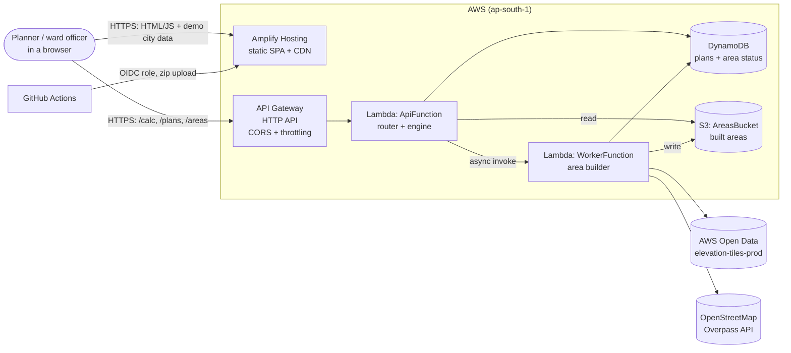
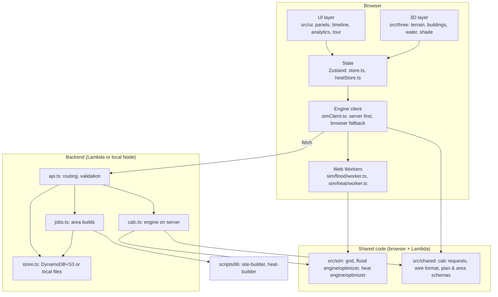
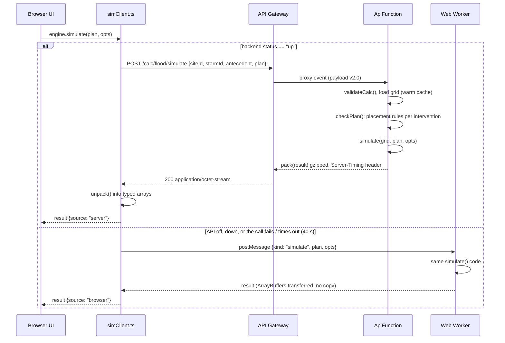
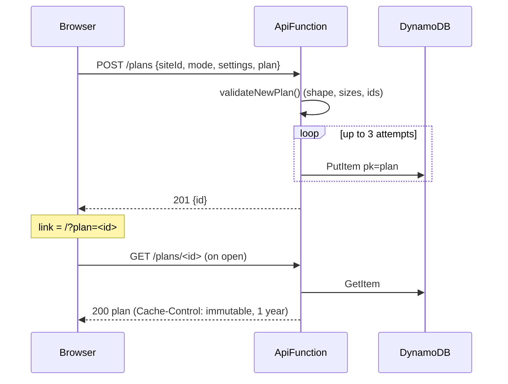
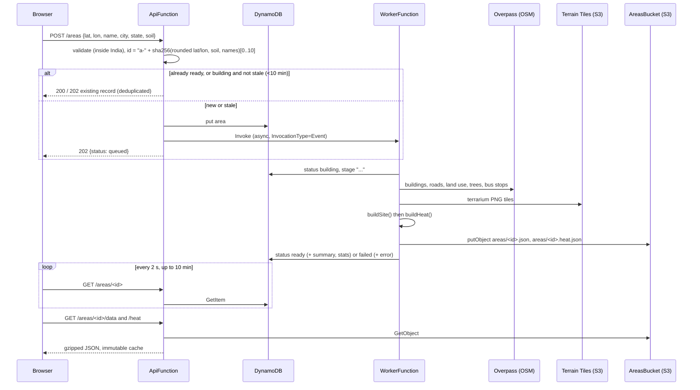
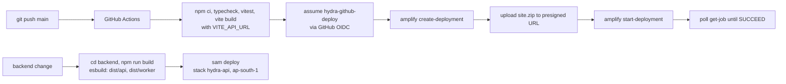
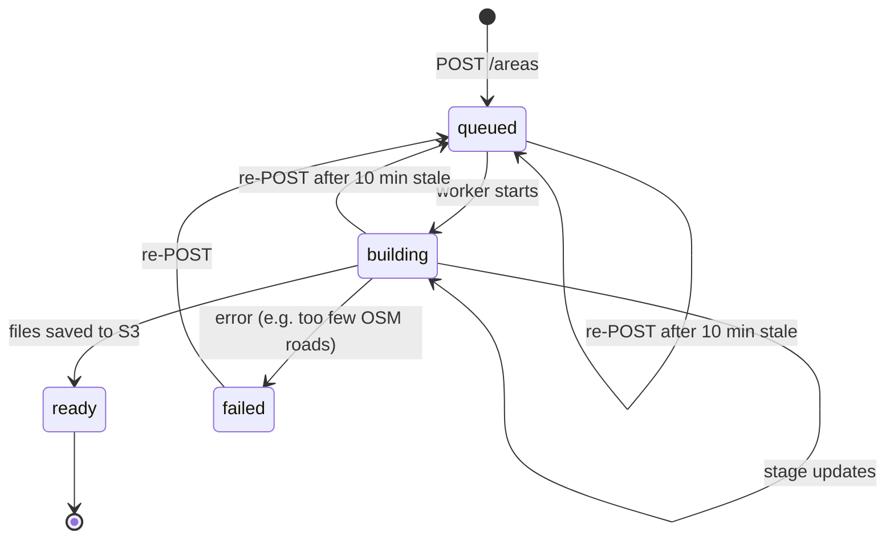
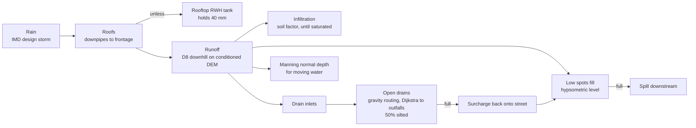
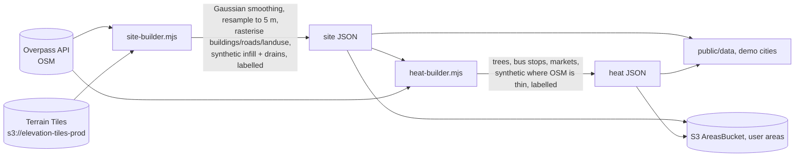

# HYDRA: technical design

This is the technical reference for HYDRA, the 3D flood and heat simulator for Indian neighbourhoods. It covers the architecture (HLD), the module-level design (LLD), the request flows, the data model, the AWS services and how the project is built and deployed.

For what the product does and the headline results, see [README.md](README.md). For status and roadmap, see [DIRECTION.md](DIRECTION.md).

---

## 1. Summary

| | |
|---|---|
| **What** | An interactive 3D simulator of a real 600 m × 600 m Indian neighbourhood with two independent modes: **Flood** (monsoon storm, drains, waterlogging) and **Heat** (sun path, shade, pedestrian heat exposure). |
| **Core idea** | A physics engine plus a greedy budget optimizer, so you can compare *no action*, *money spread evenly* and *HYDRA's plan* for the same rupee budget. |
| **Frontend** | React 19 + React Three Fiber (Three.js), Zustand, Vite. The engine runs in Web Workers. |
| **Backend** | Optional, serverless TypeScript on AWS Lambda behind API Gateway (HTTP API), with DynamoDB and S3. It runs the *same* engine code as the browser. |
| **Region** | `ap-south-1` (Mumbai) |
| **Live** | https://main.d3dmcevnvvv968.amplifyapp.com |
| **Key property** | **Offline-first.** If the API is missing or fails, the identical engine runs in the browser and the numbers match (a test checks this). |

---

## 2. AWS services used

| AWS service | Used for | Where it is defined |
|---|---|---|
| **AWS Amplify Hosting** | Hosts the static frontend (`dist/`). A manual-deploy app (no Git connection); GitHub Actions uploads each build. | [.github/workflows/deploy.yml](.github/workflows/deploy.yml), [amplify.yml](amplify.yml) |
| **Amazon API Gateway (HTTP API)** | Public REST entry point. Handles CORS (locked to the Amplify origin) and throttling (burst 20, rate 10 req/s). A single `ANY /{proxy+}` route goes to the API Lambda. | [backend/template.yaml](backend/template.yaml) |
| **AWS Lambda: `ApiFunction`** | Routes all requests. Runs the flood/heat engine for `/calc/*`, saves plans, starts area builds and serves built areas. Node.js 22, **arm64 (Graviton)**, **1769 MB (one full vCPU)**, 29 s timeout. | [backend/src/lambda-api.ts](backend/src/lambda-api.ts) |
| **AWS Lambda: `WorkerFunction`** | Background job that builds a new neighbourhood from OpenStreetMap and AWS terrain. Invoked asynchronously (`InvocationType: Event`). 1536 MB, 600 s timeout, 0 retries. | [backend/src/lambda-worker.ts](backend/src/lambda-worker.ts) |
| **Amazon DynamoDB** | One on-demand (`PAY_PER_REQUEST`) table, hash key `pk`. Holds saved/shared plans (`plan#<id>`) and area build status (`area#<id>`). | [backend/src/store.ts](backend/src/store.ts) |
| **Amazon S3: `AreasBucket`** | Stores built neighbourhoods (`areas/<id>.json`, `areas/<id>.heat.json`, ~0.5 MB each). Private (all public access blocked), SSE-S3 (AES-256) encrypted. Served only through the API. | [backend/template.yaml](backend/template.yaml) |
| **AWS Registry of Open Data: Terrain Tiles** | `s3://elevation-tiles-prod` (terrarium PNG, SRTM-derived, ~30 m). Elevation for every neighbourhood, demo or user-added. | [scripts/lib/site-builder.mjs](scripts/lib/site-builder.mjs) |
| **AWS IAM** | Least-privilege policies per function (SAM policy templates), plus the `hydra-github-deploy` role that GitHub Actions assumes via **OIDC**, so the repo stores no AWS keys. | [backend/template.yaml](backend/template.yaml), [deploy.yml](.github/workflows/deploy.yml) |
| **AWS CloudFormation / AWS SAM** | Infrastructure as code. The stack `hydra-api` is deployed with `sam deploy`. | [backend/template.yaml](backend/template.yaml), [backend/samconfig.toml](backend/samconfig.toml) |
| **Amazon CloudWatch Logs** | Default Lambda logging (`console.error` on failures and failed jobs). | implicit |

**Left out on purpose:**
- **Amazon Bedrock.** The officer brief (English + Hindi) is generated in the browser from the simulation's own numbers, which keeps the running cost at zero and the brief deterministic.
- **Amazon CloudFront.** Amplify Hosting already includes a CDN. S3 + CloudFront is the documented alternative for static hosting.

### IAM permissions per function

| Principal | Permissions |
|---|---|
| `ApiFunction` | `DynamoDBCrudPolicy` (table), `S3ReadPolicy` (areas bucket), `LambdaInvokePolicy` (worker only) |
| `WorkerFunction` | `DynamoDBCrudPolicy` (table), `S3CrudPolicy` (areas bucket) |
| `hydra-github-deploy` (OIDC) | Amplify deployment for this app's `main` branch only |

---

## 3. High-level design (HLD)

### 3.1 System context



### 3.2 Logical layers



### 3.3 Key design decisions

| Decision | Why |
|---|---|
| **One engine, two runtimes** | `src/sim` is pure TypeScript with no DOM or Node APIs. Vite bundles it into Web Workers; esbuild bundles it into Lambda. Server and browser results are identical by construction. |
| **Server first, browser fallback** | The backend is optional. A static build with no `VITE_API_URL` is a complete product; only share links and "+ Area" disappear. |
| **Server never trusts client numbers** | The client sends only ids and a plan. The server loads the site itself, re-validates every intervention against the map's placement rules and recomputes costs. |
| **Binary results** | A storm result is mostly typed arrays (water depth per cell per frame). A custom binary format (`src/shared/wire.ts`) plus gzip keeps a 6 h storm under 1 MB. |
| **Async job for area builds** | Building an area takes 20 s to a few minutes, longer than API Gateway's 29 s limit. So: API writes a job record, invokes the worker asynchronously, and the browser polls. |
| **Single-table DynamoDB** | Only two access patterns, both get-by-id. One hash key with a type prefix (`plan#`, `area#`) is enough. |
| **1769 MB Lambda** | That is exactly one full vCPU. The engine is single-threaded, so more memory buys nothing. |
| **arm64 (Graviton)** | Cheaper per GB-second, and there are no native dependencies to worry about. |
| **Flood and heat fully separate** | `src/sim/heat` never imports `src/sim/flood` and vice versa; they share only the grid. Separate workers, stores, plans and budgets. |

---

## 4. Request flows

### 4.1 Running a calculation (simulate / optimize / showdown)



On startup the app calls `GET /health` once to set the backend status to `up`, `down` or `off`. Each result panel shows where it was calculated.

### 4.2 Sharing a plan



### 4.3 Adding a new area ("+ Area")



### 4.4 Deployment (CI/CD)



The frontend redeploys on every push to `main`. The backend is deployed by hand with `sam deploy` after `npm run build`.

---

## 5. Low-level design (LLD)

### 5.1 Repository layout

```
.github/workflows/deploy.yml   CI: test, build, upload to Amplify (OIDC)
amplify.yml                    Amplify build spec (for a Git-connected app)
index.html, vite.config.ts     Vite entry and config (ES workers, es2022)

scripts/
  fetch-site.mjs               build demo flood data:  OSM + Terrain Tiles -> public/data/<site>.json
  fetch-heat.mjs               build demo heat data:   trees, stops, markets -> public/data/<site>.heat.json
  lib/site-builder.mjs         shared with the worker Lambda
  lib/heat-builder.mjs         shared with the worker Lambda
  lib/demo-sites.mjs           the 3 demo cities

public/data/                   prebuilt demo cities (Gurugram, Chennai, Ranchi) + sites.json

src/
  main.tsx, App.tsx            entry, routing by URL hash (#city, #city/heat), demo query flags
  store.ts                     Zustand: shared + flood state
  heatStore.ts                 Zustand: heat state (own plan, budget, results)
  simClient.ts                 engine facade: server first, worker fallback
  api.ts                       API client: health, calc, plans, areas, polling
  brief.ts, briefInput.ts      officer brief (EN + HI), generated in the browser
  savedPlans.ts, sharedPlan.ts saved plans (local) and share links (API)
  shared/                      contracts used by both frontend and backend
    calc.ts                    calc request types, validation, run options
    wire.ts                    binary result format (pack / unpack)
    plan.ts                    saved plan schema + validation
    area.ts                    area request, soil presets, status record, India bbox
  sim/                         the engine (pure TS)
    grid.ts, types.ts          site JSON -> typed-array grid; depression conditioning
    flood/ model, engine, optimizer, worker, types
    heat/  solar, shadow, model, engine, optimizer, worker, types
  three/                       React Three Fiber scene
    Scene, Terrain, Buildings, Effects, Ghost, split.tsx, geo.ts, useTools.ts
    flood/ Water, Interventions, Markers
    heat/  HeatLayer
  ui/                          panels, timeline, share, add area, tour, analytics, charts

backend/
  template.yaml, samconfig.toml   SAM stack hydra-api
  build.mjs                       esbuild -> dist/api, dist/worker; copies public/data into dist/api/data
  src/
    lambda-api.ts                 API Gateway v2 event -> handle()
    lambda-worker.ts              async job event -> runJob()
    local.ts                      local Node HTTP server on :8787
    api.ts                        router and plan/area handlers
    calc.ts                       /calc routes, warm grid cache
    jobs.ts                       dispatch + runJob (area builds)
    store.ts                      Store interface: awsStore / localStore
    http.ts                       CORS, JSON and gzip response helpers
    config.ts                     env-driven settings
  test/api.test.ts, calc.test.ts  Node test runner, no AWS or network
```

### 5.2 Tech stack

| Layer | Technology |
|---|---|
| Language | TypeScript (strict), ES modules |
| UI | React 19, Zustand 5 |
| 3D | Three.js 0.186, @react-three/fiber 9, @react-three/drei 10, @react-three/postprocessing |
| Maps (area picker) | Leaflet |
| Build | Vite 8 (frontend), esbuild (Lambda bundles) |
| Concurrency | Web Workers (ES module workers), Transferable ArrayBuffers |
| Tests | Vitest (engine, wire format, brief), Node test runner + tsx (backend) |
| Backend runtime | Node.js 22 on Lambda arm64; plain Node HTTP server locally |
| AWS SDK | v3: `client-dynamodb`, `lib-dynamodb`, `client-s3`, `client-lambda` |
| IaC | AWS SAM / CloudFormation |
| CI/CD | GitHub Actions + AWS CLI (Amplify manual deployments) |

### 5.3 API reference

Base URL: the `ApiUrl` output of the stack (`https://<id>.execute-api.ap-south-1.amazonaws.com`).

| Method | Path | Request | Response |
|---|---|---|---|
| GET | `/health` | none | `{ ok, storage }` |
| POST | `/plans` | `NewPlan` | `201 { id }` |
| GET | `/plans/{id}` | none | `SavedPlan`, immutable cache |
| POST | `/areas` | `AreaRequest` | `202 AreaMeta` (or `200` if already ready) |
| GET | `/areas/{id}` | none | `AreaMeta` (status, stage, error, stats) |
| GET | `/areas/{id}/data` | none | site JSON (gzip if accepted), immutable |
| GET | `/areas/{id}/heat` | none | heat JSON (gzip if accepted), immutable |
| POST | `/calc/{flood\|heat}/simulate` | `FloodCalc` / `HeatCalc` | binary (`wire.ts`), gzip |
| POST | `/calc/{flood\|heat}/optimize` | same + `budget` | JSON `OptimizeResult` |
| POST | `/calc/{flood\|heat}/showdown` | same + `budget` | JSON `ShowdownResult` |

```ts
FloodCalc = { siteId, stormId, antecedent, plan?: Intervention[], budget?: number }
HeatCalc  = { siteId, scenarioId, windowId, plan?: HeatIntervention[], budget?: number }
```

Errors return `{ error: string }` with 400 (validation), 404, 413 (body > 400 KB) or 500. Every response carries CORS headers. `/calc` responses include `Server-Timing: engine;dur=<ms>`.

**Routing** ([backend/src/api.ts](backend/src/api.ts)): the path is split into `/{root}/{id}/{sub}` and normalised to a route key such as `POST /calc/:id/simulate`, then a `switch` dispatches it. Ids must match `^[A-Za-z0-9-]{1,40}$`. The same `handle(cfg, store, req)` is called by the Lambda adapter and the local server, so there is no framework.

### 5.4 Data model

**DynamoDB table** (single table, `pk` string hash key, item `{ pk, data }`):

| `pk` | `data` | Written by | Notes |
|---|---|---|---|
| `plan#<id>` | `SavedPlan { id, v:1, createdAt, siteId, siteName, mode, settings, plan[] }` | API | `id` is 10 random chars from an unambiguous alphabet; conditional put prevents overwrite |
| `area#<id>` | `AreaMeta { id, status, stage, error?, request, createdAt, updatedAt, summary?, stats? }` | API (queued), worker (building / ready / failed) | `id = "a-" + sha256(...)[0..10]`, deterministic, so repeat requests deduplicate |

Area status machine:



**S3 (`AreasBucket`)**:

| Key | Content |
|---|---|
| `areas/<id>.json` | Site data: 5 m grid, elevation, cover, buildings, roads, drains, outfalls, data-source notes |
| `areas/<id>.heat.json` | Heat layer: trees, bus stops, markets, footfall points |

Demo cities are not in S3: `build.mjs` copies `public/data` into the Lambda bundle (`dist/api/data`), and the browser loads them from the Amplify site.

**Storage abstraction** ([backend/src/store.ts](backend/src/store.ts)): one `Store` interface (`get`, `put` with `ifAbsent`, `getFile`, `putFile`) with two implementations: `awsStore` (DynamoDB + S3) and `localStore` (JSON files under `backend/.data`, using the `wx` flag for `ifAbsent`). `STORAGE=aws` picks the AWS one.

### 5.5 Binary wire format

[src/shared/wire.ts](src/shared/wire.ts), used by Node and the browser:

```
[u32 LE header length][header JSON, UTF-8][pad to 8 bytes][array 1 bytes, padded to 8][array 2 ...]
```

During `JSON.stringify`, each typed array (`Uint8Array`, `Uint16Array`, `Int32Array`, `Float32Array`, `Float64Array`) is replaced by `{ $array: type, offset, length }` and its bytes are appended. `unpack` creates typed-array views directly over the received `ArrayBuffer` (no copy). Padding to 8 bytes keeps `Float64Array` views aligned.

### 5.6 The grid

[src/sim/grid.ts](src/sim/grid.ts) turns site JSON into typed arrays on a **5 m cell grid** (600 m box = 120 × 120 = 14,400 cells):

- `z: Float64Array`: elevation; `cover: Uint8Array`: surface type; `bldg / road / drain: Int32Array`: owner ids per cell
- Derived lists: cells per building and road, building frontage (downpipes, doorsteps), enclosed courtyards, drain units, outfalls
- **Hydrological conditioning:** priority-flood from the box edge with buildings as walls (binary heap). Closed basins deeper than **40 cm** are raised to 40 cm: shallower ones are real waterlogging spots, deeper ones are SRTM artefacts.

### 5.7 Flood engine

[src/sim/flood/engine.ts](src/sim/flood/engine.ts). Time step is one minute:



- Interventions change the physics: a drain not connected to an outfall does nothing; desilting raises capacity from 50 % to 90 %; rain gardens and recharge pits add storage and infiltration.
- **Mass balance** closes to under 0.01 m³ on 40,000 m³ storms.
- **Outputs:** per-frame water depth, drain load, max depth, time over threshold, surcharge, doorstep depth; KPIs (homes flooded, residents affected, road-km cut, waterlogged ha, road-km·hours, flood impact index).
- **Speed:** about 0.5 s per storm.

### 5.8 Flood optimizer

[src/sim/flood/optimizer.ts](src/sim/flood/optimizer.ts):

1. Simulate the storm.
2. Find harmful low spots: water above 10 cm, weighted by road class, residents at the door and critical buildings (schools, hospitals).
3. Trace where each cell's runoff ends up, including chains of low spots spilling into each other.
4. Generate and score candidates by **harmful water removed per rupee**: rooftop harvesting, rain garden, recharge pit, relief drain (Dijkstra path to a drain with spare capacity or to the trunk outfall), desilting.
5. Pick lazily and greedily within the round budget, re-simulate, refine; up to 6 rounds.
6. Every pick gets a plain-language reason.

**Showdown** = no action vs even spread (average of 3 random plans) vs HYDRA, for the same budget.

### 5.9 Heat engine

[src/sim/heat](src/sim/heat):

| Step | Module | Detail |
|---|---|---|
| Sun path | `solar.ts` | NOAA solar position equations, every 30 min, site lat/lon; clear-sky direct beam reduced by cloud |
| Shadows | `shadow.ts` | From each 5 m cell, a ray at 1.1 m height traced toward the sun through the grid. Buildings (3.2 m per storey + plinth) and terrain block; tree crowns pass 25 %, canopies 5 % |
| Exposure index | `engine.ts` | `50 × sun dose + 20 × surface heating + 30 × air heat` (NOAA heat index); wind trims sun and surface terms; 0 to 100 |
| Footfall | `model.ts` | Weights by road class; bus stops, markets, school/hospital gates and parks weigh more |

It is a relative index for comparing places and plans, not UTCI or WBGT. A full day traces in about 50 ms.

**Heat optimizer** ([optimizer.ts](src/sim/heat/optimizer.ts)): candidate trees and canopies around the busiest hot cells, scored by footfall-weighted exposure removed per rupee, with shade re-traced after each pick so overlapping shade is not counted twice. About 0.2 s for a ₹25 L budget.

### 5.10 Frontend internals

- **State:** two Zustand stores. `store.ts` holds the shared state (site, camera, mode, UI) and flood state; `heatStore.ts` holds heat state. They never share a plan or budget.
- **Engine client** ([simClient.ts](src/simClient.ts)): each mode has two workers, `sim` for quick runs and `opt` for heavy optimisation, so the UI stays responsive while optimising. Requests are matched by sequence id; progress messages stream back. `either(remote, local)` implements server-first with fallback.
- **Zero-copy transfer:** simulation buffers are passed as `Transferable`s from worker to main thread.
- **3D scene:** terrain mesh from the DEM, extruded OSM buildings, animated water surface from depth frames, drains coloured by state (flowing, full, overflowing), heat ground overlay and pins, ghost previews for placement, before/after split view.
- **URL contract:** `#<city>`, `#<city>/heat`, `?plan=<id>`, `?demo=plan|showdown`, `?tour`, `noguide`.
- **Officer brief** ([brief.ts](src/brief.ts)): template-based, English and Hindi, built from the before/after numbers. No LLM call.
- **Local persistence:** `localStorage` only for per-viewer conveniences (added areas list, saved plans); every access is wrapped in try/catch.

### 5.11 Data pipeline



The same builders run in `npm run data` (demo cities) and in the worker Lambda (user areas). Synthetic data (building infill, levels, plinths, residents, drain layout and silt, soil factors, trees, some bus stops) is flagged in the data and shown in the app's *Data sources* toggle.

---

## 6. Non-functional properties

### 6.1 Performance

| Operation | Time |
|---|---|
| Flood storm simulation | ~0.5 s (browser), ~1 s on Lambda |
| Flood recommendation | ~4–7 s |
| Heat day trace | ~50 ms |
| Heat recommendation (₹25 L) | ~0.2 s |
| Storm result over the wire | < 1 MB gzipped, 6 h storm |
| Site grid load | ~100 ms, cached while the Lambda is warm (LRU of 8 sites) |
| Area build | 20 s to a few minutes |

### 6.2 Security

- **Input validation at the boundary:** body size limit (400 KB), JSON parse guard, id regex, schema validators shared with the frontend (`validateNewPlan`, `validateAreaRequest`, `validateCalc`), item caps (1,500 interventions, 600 cells each), India bounding box for areas.
- **Server-side recomputation:** placement rules and costs are re-checked on the server; no result number comes from the client.
- **Least-privilege IAM:** the API can only read S3; only the worker writes to it.
- **Private, encrypted S3:** public access fully blocked, SSE-S3.
- **CORS** restricted to the Amplify origin in production.
- **API Gateway throttling:** burst 20, 10 req/s.
- **No long-lived secrets:** GitHub Actions uses OIDC to assume a narrowly scoped role.
- **No PII stored:** plans and areas contain only geometry and settings.

### 6.3 Reliability

- Browser fallback for every calculation if the API is down, slow (40 s timeout) or errors.
- Conditional writes avoid plan-id collisions (3 retries).
- Stale build detection (10 min) lets an area build restart if the worker died; worker retries are off to avoid duplicate builds.
- Deterministic area ids deduplicate concurrent requests for the same spot.
- Immutable caching on plans and built areas, since they never change.

### 6.4 Cost

Everything scales to zero: Lambda (pay per request), DynamoDB on-demand, S3 for a few MB, Amplify Hosting. No Bedrock, no always-on compute.

---

## 7. Testing

| Suite | Runner | Covers |
|---|---|---|
| `src/sim/flood/engine.test.ts` | Vitest | mass balance, drain behaviour, interventions |
| `src/sim/flood/optimizer.test.ts` | Vitest | HYDRA vs even spread per city (the README's numbers) |
| `src/sim/heat/engine.test.ts`, `optimizer.test.ts` | Vitest | sun, shade, exposure, heat plans |
| `src/shared/wire.test.ts` | Vitest | pack/unpack round trip |
| `src/brief.test.ts` | Vitest | officer brief |
| `backend/test/api.test.ts` | node --test | routes, validation, plans, areas (local store) |
| `backend/test/calc.test.ts` | node --test | server results equal browser results |

CI runs typecheck and Vitest on every push before deploying.

---

## 8. Running and deploying

```bash
# frontend
npm install
npm run dev              # http://localhost:5173
npm test                 # engine tests
npm run data             # rebuild demo flood data (OSM + AWS Terrain Tiles)
npm run data:heat        # rebuild demo heat data

# backend, locally (files in backend/.data, no AWS)
npm --prefix backend install
npm run api              # http://localhost:8787
npm run api:test

# backend on AWS
cd backend && npm run build && sam deploy    # stack hydra-api, ap-south-1
```

| Env var | Where | Purpose |
|---|---|---|
| `VITE_API_URL` | frontend build | API base URL; empty means fully static |
| `STORAGE` | Lambda | `aws` or `local` |
| `TABLE_NAME`, `BUCKET_NAME` | Lambda | DynamoDB table, S3 bucket |
| `WORKER_FUNCTION` | API Lambda | worker to invoke |
| `ALLOW_ORIGIN` | API Lambda | CORS origin |
| `SITE_DATA_DIR`, `DATA_DIR` | backend | demo data path, local storage path |

---

## 9. Known limits and next steps

- The neighbourhood is a fixed 600 m square; a ward-boundary upload is on the roadmap.
- Drain layout, silt state, soil factors and many trees are synthetic (labelled in the app).
- The heat index is relative, not a health metric; next step is calibrating the surface term with Landsat land-surface temperature.
- The Lambda's warm-cache scope is per container; a shared cache (for example ElastiCache) only matters at much higher traffic.
- The backend is deployed by hand; adding `sam deploy` to CI would close that gap.
